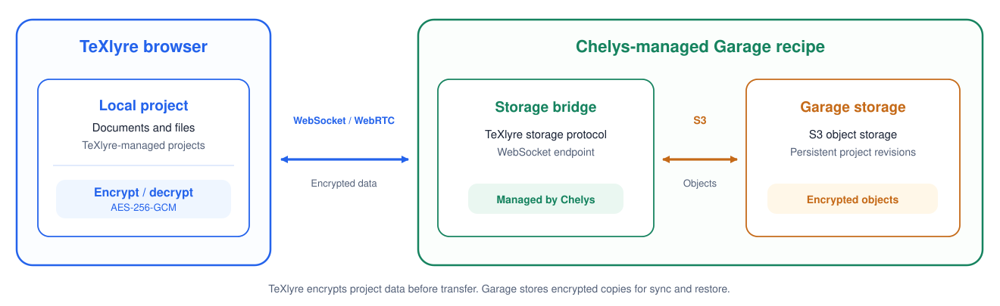
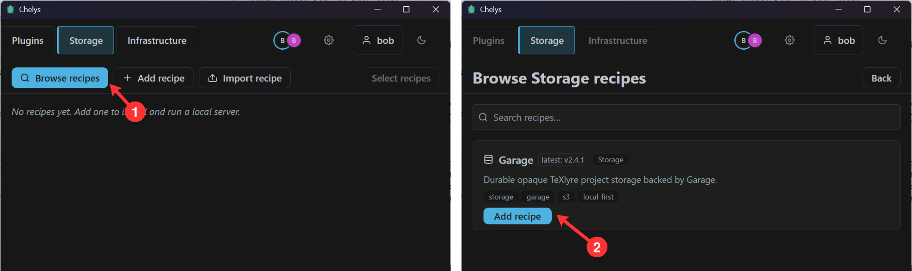
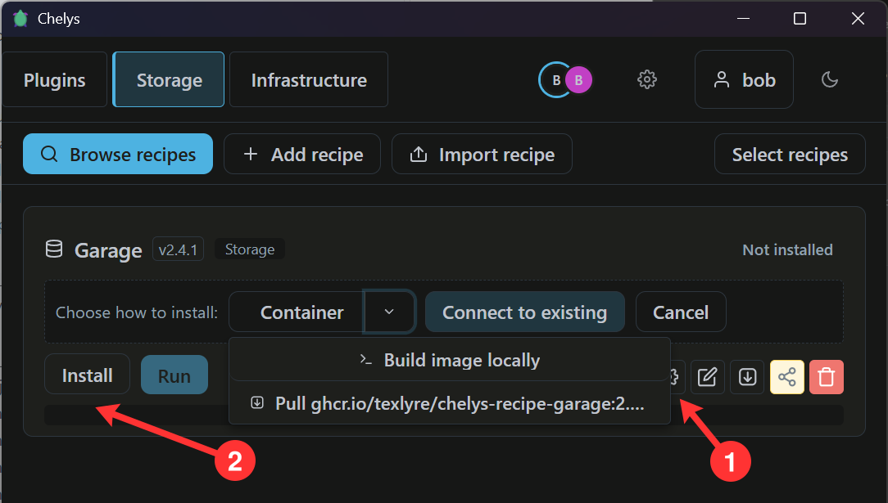
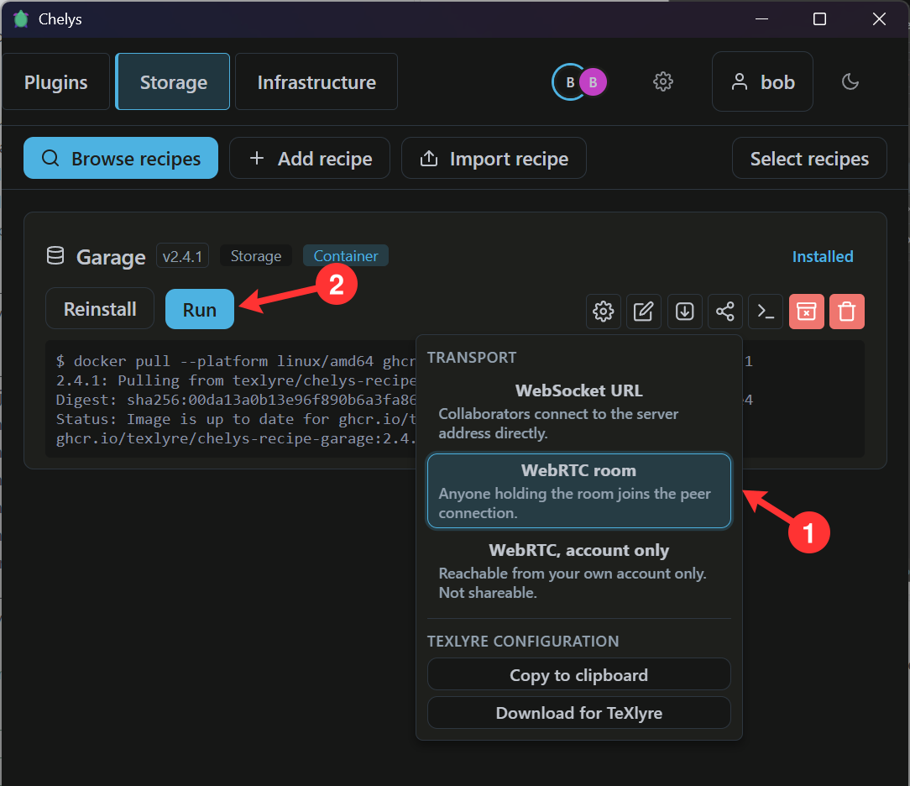
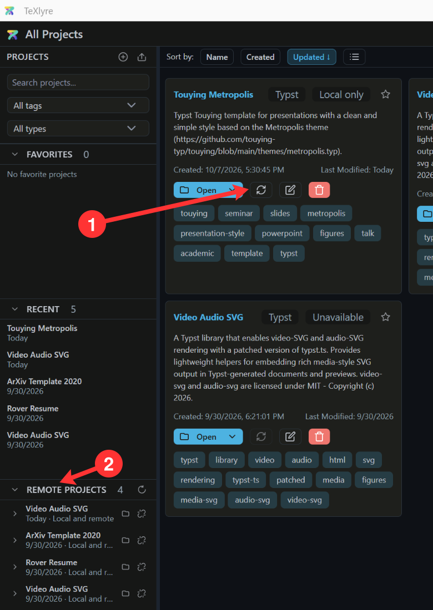
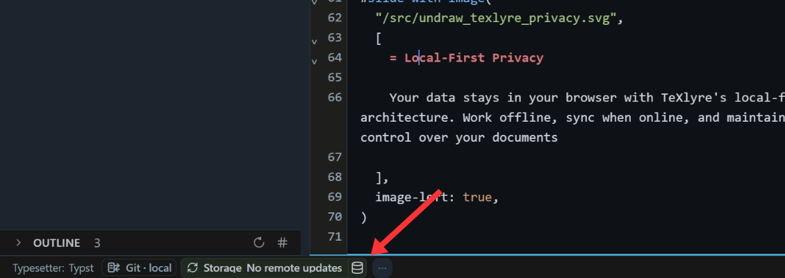
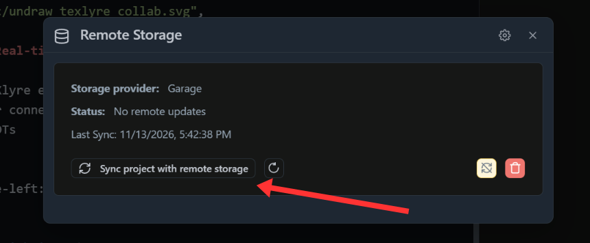

:::info[Part of the NGI0 Core roadmap]

This post reports on Task 6 of TeXlyre's NGI0 Commons grant. For the full project roadmap, see [TeXlyre joins NGI0 Commons](/blog/nlnet-ngi0-funding-overview).

:::

TeXlyre can now store encrypted copies of projects outside the browser using [Garage](https://garagehq.deuxfleurs.fr/). The storage service runs through Chelys, while TeXlyre keeps a local working copy in the browser as it currently does. You can sync projects to storage and restore them later when the storage service is reachable.

## Background

TeXlyre saves projects in the browser. Remote storage adds yet another option to keep project copies, making it easier to recover or continue work on another device. The storage system handles TeXlyre-managed projects, including their documents and files.

The work covers three repositories:

- [texlyre](https://github.com/TeXlyre/texlyre/tree/nlnet_032026_T6-external-storage): project encryption, syncing, and restore controls.
- [chelys](https://github.com/TeXlyre/chelys/tree/nlnet_032026_T6-external-storage): storage provider setup and connections.
- [chelys-recipes](https://github.com/TeXlyre/chelys-recipes/tree/nlnet_032026_T6-external-storage): the Garage recipe and storage bridge.

## Milestone 6a: Encrypted project storage

TeXlyre encrypts project content in the browser before sending it to remote storage. It uses AES-256-GCM and separate keys for each project. The project list stored remotely is encrypted too, protecting the project content and obfuscating the project ID, name, desription, etc. Note that the encryption and decryption takes place within TeXlyre (browser-side) protecting the project data both during transfer and persistence in the S3-compatible storage.

After the first upload, TeXlyre can sync further changes and check for updates from storage. Moreover, project storage can be shared with peers, allowing them to connect to the same storage backend even when the original sharer's TeXlyre is offline. Similar to other recipes such as LSP and typesetters, the direct room ID for establishing the connection could be shared with a peer or peers in order to connect to the same WebRTC storage adapter and pair with Chelys' communication protocol. However, in addition to the room ID, the project's unique and encrypted identifier are shared with the peer. This allows their TeXlyre instance to request the project files associated with that identifier without revealing critical information such as the project ID to the backend storage server.

Only the original project owner (sharer) can delete a project from remote storage, while collaborators can still update its content. This is achieved using a separate, randomly generated 256-bit deletion authorization key, stored in the owner's encrypted account info and kept separate from the project encryption key shared with collaborators.

## Milestone 6b: Garage storage through Chelys

The new Garage recipe runs a storage bridge and Garage together in Docker or Podman. Chelys manages the service and makes it available to TeXlyre over WebSocket (possible as standalone without Chelys), with WebRTC (only possible with Chelys) available for remote connections to be shared with peers that are not directly connected to the Chelys instance. Garage keeps encrypted project objects and their revisions in persistent storage, creating a Docker volume for the stored data.

*Encryption and decryption is done within TeXlyre. The storage bridge transfers encrypted project data to and from Garage.*

## Walkthrough: Store and restore a project

1. Install [Chelys](https://github.com/TeXlyre/chelys) and pair it with TeXlyre as described in the [Task 2 walkthrough](/blog/chelys-lsp-bridge). Make sure Docker or Podman is available.

2. In Chelys, open **Storage → Browse recipes** (1), then click **Add recipe** for **Garage** (2).

   

3. Choose **Container**, then select the prebuilt Garage image from the dropdown (1) and click **Install** (2). You can also build the image locally.

   

4. Keep the **WebSocket URL** transport for local access, or choose **WebRTC room** (1) to share the storage connection with remote peers. Click **Run** (2).

   

5. In TeXlyre, check **Settings → External Tools → Remote Storage** for the Garage provider. Enter your TeXlyre password if prompted to unlock encrypted storage. In the project list, click the storage sync button next to a local project to **Store project** (1). Stored copies appear under **Remote Projects** (2).

   

6. Open the stored project. The **Storage** status in the editor footer shows whether remote updates are available. Click it to view the storage details.

   

   In the **Remote Storage** dialog, click **Sync project with remote storage** to sync manually.

   

7. To restore a stored project on another device, open **Remote Projects** and choose **Restore & Open** for a remote-only project. The device must be able to reach the storage provider through a reachable WebSocket address or WebRTC transport.

## Acknowledgements

This work was funded by [NLnet Foundation](https://nlnet.nl/project/TeXlyre/) as part of the TeXlyre project.
